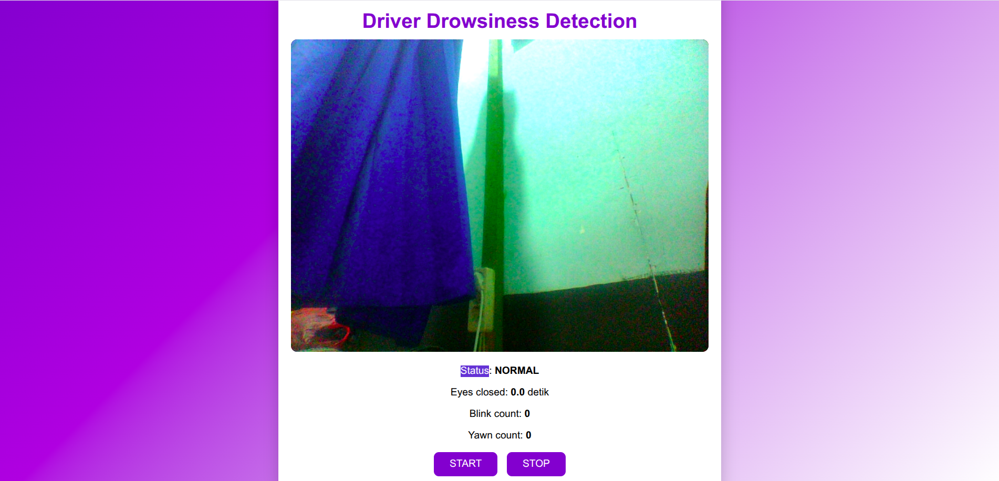

# Driver Drowsiness Detection System


A browser-based academic prototype that explores driver drowsiness monitoring using **MediaPipe Face Mesh**, the **Eye Aspect Ratio (EAR)**, and mouth-opening cues. The application processes webcam frames in the browser, displays the current status and counters, and plays an audio alert when configured warning conditions are reached.

> **Project status:** Academic prototype. This project has not been validated for real-world vehicle safety and must not be used as a substitute for driver rest or certified safety systems.

## Application Preview



The interface shows the camera preview, status indicator, eye-closure duration, blink counter, yawn counter, and START/STOP controls.

## Features

- **Face landmark analysis:** Uses MediaPipe Face Mesh to obtain facial landmarks from the webcam feed.
- **Eye closure estimation with EAR:** Calculates an Eye Aspect Ratio from selected eye landmarks and smooths recent EAR values.
- **Mouth-opening cue with MAR:** Calculates a Mouth Aspect Ratio as a simple indicator associated with yawning.
- **Status indicators:** Displays `NORMAL`, `WASPADA` (warning), or `BAHAYA` (danger) based on the current detection logic.
- **Blink and yawn counters:** Tracks short eye closures and sustained mouth-opening events according to the configured thresholds.
- **Audio alerts:** Includes warning and danger alarm audio files.
- **Browser-based processing:** The project code sends webcam frames to the in-browser MediaPipe pipeline; it does not implement a backend endpoint for uploading camera frames.
- **Start/stop controls:** Lets the user start or stop camera-based detection.

## How It Works

### 1. Eye Aspect Ratio (EAR)

The application estimates eye openness using six landmarks for each eye. The EAR is calculated from the vertical distances between eyelid landmarks divided by the horizontal distance across the eye:

$$
\mathrm{EAR} = \frac{\|P_2-P_6\| + \|P_3-P_5\|}{2\|P_1-P_4\|}
$$

When the eyes close, the vertical distances typically decrease and the EAR tends to become smaller. The application compares the smoothed EAR with a configurable threshold to estimate eye closure duration.

### 2. Mouth Aspect Ratio (MAR)

The project also calculates a simple mouth-opening ratio from upper/lower lip landmarks and the horizontal mouth width. Sustained mouth opening is counted as a yawn-related event according to the configured time threshold. Mouth opening alone is not definitive proof of a yawn.

### 3. Current Detection Parameters

The following values are defined in `script.js` and can be adjusted for experimentation:

| Parameter | Current value | Purpose |
|---|---:|---|
| EAR threshold | `0.16` | Threshold used to estimate eye closure |
| MAR threshold | `0.45` | Threshold used for mouth-opening events |
| Warning duration | `500 ms` | Eye-closure duration for the warning state |
| Danger duration | `1000 ms` | Eye-closure duration for the danger state |
| Yawn-related duration | `1200 ms` | Sustained mouth-opening duration before counting an event |
| Yawn count limit | `3` | Count that triggers the danger state |

These are experimental heuristic settings, not universal or scientifically validated safety thresholds. Results can vary with camera placement, lighting, face position, and individual facial characteristics.

## Tech Stack

- **Frontend:** HTML5, CSS3, vanilla JavaScript
- **Computer vision:** MediaPipe Face Mesh
- **Camera and rendering:** MediaPipe Camera Utils and HTML Canvas
- **Audio:** HTML audio playback

No application backend or database is required for the current prototype. The MediaPipe scripts are loaded from a CDN, so an internet connection is needed when loading the app unless those dependencies are configured locally.

## Project Structure

```text
.
├── index.html
├── style.css
├── script.js
├── alarm-sirene-ringan.mp3
├── alarm-sirene-keras.mp3
├── assets/
│   └── driver-drowsiness-detection-preview.png
└── README.md
```

## Run Locally

A local HTTP server is recommended rather than opening `index.html` directly with a `file://` URL. The browser must be allowed to access your webcam.

### Option 1: Python HTTP server

1. Clone the repository:

   ```bash
   git clone https://github.com/fadhlulloh123/driver-drowsiness-detection.git
   cd driver-drowsiness-detection
   ```

2. Start the server:

   ```bash
   python3 -m http.server 8000
   ```

3. Open [http://localhost:8000](http://localhost:8000) in your browser.
4. Allow camera access and select **START**. Select **STOP** to stop detection.

### Option 2: VS Code Live Server

1. Clone and open the repository in Visual Studio Code.
2. Install the **Live Server** extension if it is not already installed.
3. Open `index.html` with Live Server.
4. Allow webcam access in the browser and select **START**.

## Limitations and Responsible Use

- This is an academic prototype, not a certified driver-safety product.
- Detection depends on camera quality, lighting, face visibility, and threshold configuration.
- EAR/MAR thresholds may need calibration and can produce false positives or false negatives.
- The project has not been evaluated through a formal dataset-based performance study or real-world driving validation.
- Do not use this application as the sole basis for deciding whether someone is safe to drive.
- Confirm that the included alarm audio files may be redistributed before publishing the repository publicly.

## Future Improvements

- Draw facial landmarks and EAR/MAR measurements on the preview for better interpretability.
- Add a calibration step for different users and camera setups.
- Evaluate detection performance on recorded test cases and report metrics such as precision, recall, and false-alarm rate.
- Improve accessibility, mobile responsiveness, and user-facing instructions.
- Deploy a demo with GitHub Pages after testing camera permissions in the target browser.

## Author

**Muhammad Fadhlulloh**  
GitHub: [@fadhlulloh123](https://github.com/fadhlulloh123)

---

*Developed as an academic Computer Vision project to explore browser-based drowsiness indicators using facial landmarks.*
